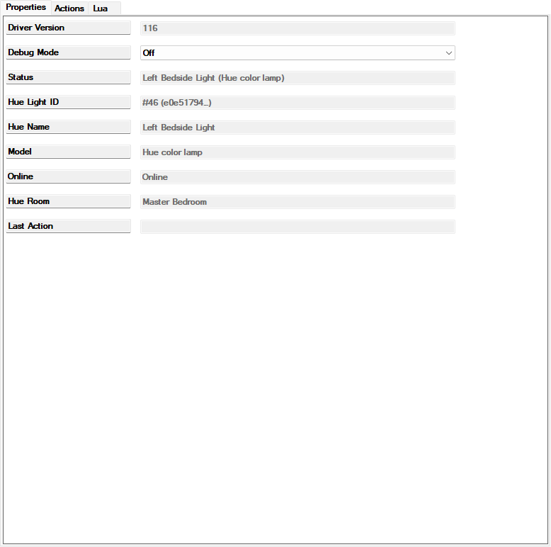
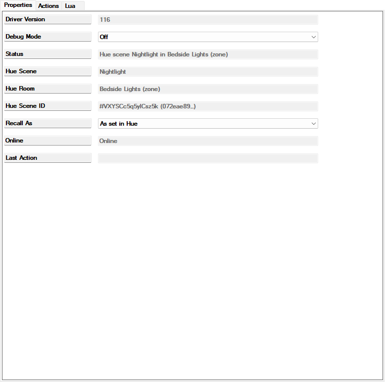
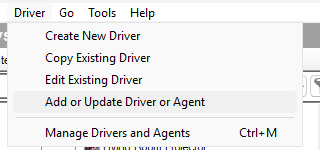

# Control4 drivers for Philips Hue

[](https://github.com/corytron/c4-hue-driver/actions/workflows/ci.yml)
[](https://scorecard.dev/viewer/?uri=github.com/corytron/c4-hue-driver)
[](https://github.com/corytron/c4-hue-driver/releases/latest)
[](CHANGELOG.md)
[](LICENSE)

**Documents:** [Changelog](CHANGELOG.md) · [Current state](docs/status.md) ·
[Design notes](docs/README.md) ·
[Contributing](CONTRIBUTING.md) · [Security policy](SECURITY.md) ·
[Code of conduct](CODE_OF_CONDUCT.md) · [License](LICENSE) and [notice](NOTICE)

Four Control4 DriverWorks drivers that work with one Philips Hue bridge over
the bridge's local CLIP v2 API: **Hue Bridge**, **Hue Light**, **Hue Scene**
and **Hue Motion Sensor**. They turn the bridge's lights, rooms, zones, scenes
and motion sensors into ordinary Control4 devices that you switch, dim, colour
and program in Composer Pro like any other. Everything stays on the local
network: no cloud account and no internet access are involved.

An independent personal project for one Control4 home, offered as is. It is
not affiliated with, endorsed by or supported by Snap One (Control4) or
Signify (Philips Hue); see
[License, trademarks and provenance](#license-trademarks-and-provenance).
To try it: [what you need](#what-you-need), [download](#download),
[install](#install-in-composer-pro).

## What it does

### The four drivers

| Driver | Package | What it is in Control4 |
| --- | --- | --- |
| **Hue Bridge** | `hue_bridge.c4z` | One per project. Pairs with one Hue bridge, talks to it, and creates and links the other devices from its actions. It has no tile. |
| **Hue Light** | `hue_light.c4z` | One Hue light, or a whole Hue room or zone as one light (a zone light): a Control4 light (`light_v2` proxy) with dimming, and colour temperature and colour where the lamps have them. |
| **Hue Scene** | `hue_scene.c4z` | One Hue scene, ordinary or time-of-day: a Control4 dimmer (`light_v2` proxy). On plays the scene; off turns its Hue room or zone off. |
| **Hue Motion Sensor** | `hue_motion.c4z` | One Hue motion sensor, or one MotionAware area of a Hue Bridge Pro: Control4's stock motion sensor. |

The bridge creates the other three; you do not add them from Composer's
Items pane. Install all four from the same release.

### Features

- **Lights.** Each Hue light you add becomes a Control4 light with on/off,
  dimming, colour temperature and full colour where the bulb supports them;
  a white-only bulb shows no colour controls. A zone light's tile, slider and
  colour controls move every lamp of its Hue room or zone with one request to
  the bridge. Hue Lights can join Control4 load groups.
- **Scenes.** Any Hue scene, the time-of-day scenes (Golden hours, Natural
  light) included, can be a Hue Scene device. Its tile follows its own scene:
  it shows the room or zone's brightness while that scene is playing, and 0
  otherwise. The slider brightens or dims the room or zone while keeping the
  scene's look, and switches to the scene when it is not playing. On a
  time-of-day scene, on starts the schedule.
- **Motion sensors.** Each Hue motion sensor, and each MotionAware area of a
  Hue Bridge Pro, is a Control4 motion sensor with the stock "senses motion"
  programming and an occupancy hold time; a sensor also brings its light
  level, temperature (also as an output for a thermostat or a temperature
  display) and battery.
- **Keypads.** On a keypad, a Hue Light or Hue Scene behaves like a Control4
  dimmer: bind the keypad's buttons to its Top, Bottom or Toggle Button Link,
  and a tap ramps on or off (a second tap stops the ramp), a hold dims until
  released, and the LEDs follow the device, also after changes made in Hue.
  The devices fire a dimmer's button events in programming, and Composer
  lists a dimmer's keypad settings for them.
- **Live two-way state.** The driver keeps the bridge's event stream open, so
  changes made in the Hue app, with Hue switches or by Hue automations show
  in Control4 within a second or two, and Control4 programming reacts to
  them. Nothing is polled; the driver also reads the whole bridge when the
  stream connects and every few hours as a check behind it.
- **Pairing from Composer.** Pick the bridge in **Bridges Found** (the driver
  looks for Hue bridges on the local network) or type its address, then press
  the bridge's link button within two minutes. The application key is stored
  encrypted on the controller and never shown. HTTPS only: the bridge's
  certificate is checked against Signify's root certificates, which ship
  with the driver, and before anything carries the key the driver checks
  that the bridge at the address is the paired one (by its bridge id) and
  that the controller really applies those roots (a TLS self-check).
- **Ten actions, and the rest by itself.** The Hue Bridge has ten actions:
  Pair Bridge, Import All New, Add From Hue, Link Device, Forget Device,
  Resolve Names, Set Room Mapping, Hue Automations, Diagnostics and Forget
  Pairing. A Hue Light and a Hue Scene have none, a Hue Motion Sensor one
  (Test Motion Programming). Reading the bridge again, re-checking a
  rejected key, following the bridge to a new address and mapping new Hue
  rooms by name happen without a click.
- **Rooms.** Each Hue room or zone maps to one Control4 room, by name or with
  Set Room Mapping. New lights, zone lights and motion sensors go into the
  mapped room or a Control4 room you pick; scenes go only into their mapped
  room. A mapping never moves a device that is already there.
- **Lifecycle.** A name changed on either side follows on the other
  (Composer's name wins when both changed). A bulb or sensor that comes back
  with the same radio is re-linked by itself. Lights replaced or deleted in
  Hue, devices deleted in Composer, a bridge reset or replaced, a project
  restored from a backup: each is reported in **Attention** and resolved with
  a click. The driver never creates, moves or deletes a Control4 device on
  its own.
- **Hue automations.** The bridge lists the automations stored on the Hue
  bridge, points out in Attention the ones that move lights Control4
  controls, and switches one off in Hue when you pick it (it never deletes
  one), so that Control4 stays in charge of the lights.
- **The bridge offline.** A command the bridge did not take never shows as
  done. After 5 minutes without the bridge every Hue device goes offline, and
  they all come back at its first answer.
- **Readable Composer properties.** Status, Event Stream, Lights, Scenes, Zone
  Lights, Motion Sensors, Room Mappings, Hue Automations, Attention and Last
  Action say in plain words what the driver is doing and what it did; long
  lists open as drop-downs, and a long Attention or Last Action continues on
  up to five more rows.
- **Polite to the bridge.** Commands are coalesced per light (a fast slider
  drag sends only the latest value) and paced at Hue's limits: about ten
  light commands a second, one grouped command a second.

### What it looks like in Composer Pro

<!-- Pictures: the manual's (src/hue_bridge/www/img/), retaken with invented
     names for #61 (docs/screenshots-plan.md). bridge-actions.png and
     add-zone-light.png show the actions of 1.0 and stay out of this page
     until they are retaken; never reference bridge-properties.png here
     (docs/licensing-research.md, P3). -->

 

A Hue Light's and a Hue Scene's Properties pages, with example names. The
pictures are the manual's and come from an earlier build, so rows added since,
such as Load Groups and Keypad Follows, are not in them.

## Status and compatibility

The drivers run one home every day. [`docs/status.md`](docs/status.md) is the
one-page current state: what the four drivers do today, what was verified on
hardware and what is open. Every open item is an
[issue](https://github.com/corytron/c4-hue-driver/issues); what each release
changed is in the [changelog](CHANGELOG.md).

### What you need

- A Control4 controller on **OS 3.3.0 or newer** (the minimum the four
  drivers declare) and Composer Pro. The drivers are meant for OS 3.x and
  4.x. They were written and tested on **OS 3.4.2 with Composer Pro 3.4.2**,
  and a tester ran the 1.1 prereleases on OS 3.4.3; OS 4 has not been tried.
  Where the drivers rely on behaviour measured on OS 3.4.2 (the event
  stream's own network connection, the controller applying the driver's root
  certificates), they check it at every start and fall back or stop safely.
- A **Hue Bridge Pro** (BSB003; the author's) or a **Hue Bridge v2** (the
  square bridge, BSB002; a tester's), on the same network as the controller.
  The round first-generation bridge (BSB001) has no CLIP v2 API and is
  refused at pairing, as is a device that is not a Hue bridge. The bridge's
  software must be 1948086000 or newer (keep it updated in the Hue app; the
  driver shows it as Bridge Firmware).
- Preferably a fixed IPv4 address for the bridge (a DHCP reservation in your
  router). The driver finds the bridge on the local network by itself (mDNS,
  then a search of at most two nearby address blocks; never through the
  internet) and follows it to a new address; a bridge on another VLAN is
  entered by its address.
- HTTPS from the controller to the bridge on port 443. No internet access
  and no Hue account.

### Limits

- One bridge per project; a second Hue Bridge device is not supported.
- Not represented as Control4 devices: Hue buttons, dimmer switches and other
  switches (what they do to the lights still shows), entertainment areas,
  the motion of a whole Hue room or zone, and Hue cameras. Hue automations
  are not devices either; the bridge lists them (above).
- Hue's whole-home group ("all lights") is not offered as a light; make a Hue
  zone of all the lights and add that zone instead. The whole home's scenes
  can be added once Set Room Mapping maps the whole home to a Control4 room.
- In a room's List View, Hue Lights and Hue Scenes show Control4's standard
  light picture; the drivers' icons appear in the project tree only (#60).
- A personal project, offered as is: there is no support obligation, and
  your Control4 dealer may not support third-party drivers. Try it on a test
  system first and keep a Composer backup.

## Download

The four drivers of the latest release; install all four, from the same
release:

- [**hue_bridge.c4z**](https://github.com/corytron/c4-hue-driver/releases/latest/download/hue_bridge.c4z): Hue Bridge
- [**hue_light.c4z**](https://github.com/corytron/c4-hue-driver/releases/latest/download/hue_light.c4z): Hue Light
- [**hue_scene.c4z**](https://github.com/corytron/c4-hue-driver/releases/latest/download/hue_scene.c4z): Hue Scene
- [**hue_motion.c4z**](https://github.com/corytron/c4-hue-driver/releases/latest/download/hue_motion.c4z): Hue Motion Sensor

Their checksums are in
[`SHA256SUMS.txt`](https://github.com/corytron/c4-hue-driver/releases/latest/download/SHA256SUMS.txt).
The [release page](https://github.com/corytron/c4-hue-driver/releases/latest)
has the release notes, which say what changed, and the other files below.
Then: [Install in Composer Pro](#install-in-composer-pro).

### What a release contains

Releases are numbered `X.Y`, tagged `vX.Y` and named; each release's notes
open with what its name means. The newest is marked **Latest** on the
[Releases page](https://github.com/corytron/c4-hue-driver/releases), and the
links above always serve it. Every release is built and attached by the
repository's Release workflow, never by hand, and carries eight files:

- `hue_bridge.c4z`, `hue_light.c4z`, `hue_motion.c4z`, `hue_scene.c4z`: the
  four drivers.
- `SHA256SUMS.txt`: the checksum of each package.
- `manifest.json`: what was built: `tag` and `version`, `build`, `commit`,
  `built_at`, `dev` (`false` in a release), and each package's `sha256` and
  size.
- `attestations.sigstore.json`: the Sigstore bundle of the build provenance
  the Release workflow signed for the packages (one attestation naming all
  four).
- `hue-drivers.intoto.jsonl`: the same provenance as in-toto JSON lines.

The **build number** is the integer the four drivers show as **Driver
Version** in Composer once installed (Control4 needs an integer there); the
release notes and `manifest.json` name it. A version can be published again
as a newer build: the Release workflow then moves the tag `vX.Y` and replaces
the files, and Driver Version tells the builds apart.

### Verify a download

In the folder that holds the downloaded files, with GitHub CLI 2.102.0 or
newer:

```sh
sha256sum -c SHA256SUMS.txt
for f in *.c4z; do
  gh attestation verify "$f" --repo corytron/c4-hue-driver \
    --signer-workflow corytron/c4-hue-driver/.github/workflows/release.yml
done
```

The first command checks the files against the checksums; the second
confirms that each package was built and signed by this repository's Release
workflow, and fails otherwise. Add `--source-digest` with the `commit` from
`manifest.json` to confirm the commit as well, or
`--bundle attestations.sigstore.json` to check against the attached bundle
instead of the copy on GitHub. Older GitHub CLI versions match
`--signer-workflow` only as a prefix (advisory GHSA-wjmr-j3rp-mh2g). A
package that fails either check was not built by the Release workflow: do
not install it, and report it ([SECURITY.md](SECURITY.md)).

### Prereleases

Prereleases for testers (`X.Y-beta.N`) are on the same Releases page, marked
**Pre-release**. They are never **Latest**, the links above never serve
them, and their tags never move. Their notes say how to install one, how to
go back to the stable release, and how to report with the
[Beta feedback form](https://github.com/corytron/c4-hue-driver/issues/new?template=beta-feedback.yml).

## Install in Composer Pro

The **Documentation** tab of the **Hue Bridge** device is the full owner's
manual; its chapters on installation, pairing, rooms, importing lights and
scenes are the long version of these steps.

1. Copy the four `.c4z` files to the computer that runs Composer Pro.
2. **Driver > Add or Update Driver or Agent...**, select all four files at
   once (hold Ctrl) and open them. Composer answers *Update Succeeded*.
3. In System Design, select the room for the bridge, open the Items pane's
   **Search** tab and type `Hue Bridge`. Pick the **Hue Bridge** by
   manufacturer *Philips Hue* with the model text *Hue Bridge (CLIP v2)* (the
   search also finds Control4's own Hue drivers) and double-click it. Do not
   add a Hue Light, Hue Scene or Hue Motion Sensor from the Items pane: the
   bridge creates them.
4. On the bridge's **Properties** tab, open **Bridges Found**, pick your
   bridge and click the row's **Set** button; or type the bridge's address
   into **Bridge IP Address** (the Hue app shows it under Settings > My Hue
   system) and click that row's **Set**. On a driver that is not paired
   either one opens the pairing window: Status reads *Pairing: found Hue
   Bridge Pro (BSB003) ..., requesting key*, then *Press the link button on
   the Hue bridge (waiting 1:57)* and counts down (**Pair Bridge** on the
   **Actions** tab opens it again).
5. Press the round **link button** on the bridge within those two minutes.
   Status goes on to *Checking the bridge at ... before anything is sent*,
   then **Paired**; Bridge ID, Bridge Model, Bridge Name and Bridge Firmware
   fill in, Event Stream reads *Connected since ...*, Lights reads for
   example *8 lights on bridge, 0 imported, 8 new*, Attention lists the new
   lights, and Room Mappings maps every Hue room or zone whose name exactly
   one Control4 room has.
6. **Rooms.** Open the Room Mappings drop-down and map what is still
   *(unmapped)* with **Set Room Mapping**, zones too. A mapping decides where
   new devices land, and a scene can only go into the Control4 room its Hue
   room or zone maps to; a mapping never moves anything. A Hue room that
   appears later is mapped by name by itself, and Last Action says so.
7. **Lights and motion sensors.** **Import All New** creates every new light
   and motion sensor whose Hue room is mapped. **Add From Hue** creates one
   light, a Hue zone or room as one light, a motion sensor or a MotionAware
   area, in a Control4 room you pick: its list opens in folders (double-click
   a folder to open it).
8. **Scenes.** **Add From Hue** has a folder of scenes for each Hue room or
   zone: open it and pick one scene, or pick the folder itself for all the
   scenes of that room or zone. They go into the Control4 room it maps to.
9. **File > Refresh Navigators**, so the touch screens and the Control4 app
   show the new tiles.

The manual on the bridge's Documentation tab always matches the build
installed; releases before 1.2 had other actions.



### Updating

Updates go through the same **Add or Update Driver or Agent...** menu with the
four new files: Composer pushes the new version to every existing device, and
the pairing, the lights, the scenes and the motion sensors are untouched.
**Always update in place; never delete and re-add the Hue Bridge device.**
The pairing and the list of which device is which light live on it; a
re-added bridge starts empty.

If Composer asks **Restart Director?**, the new build changes a driver's
capabilities. Answer Yes, then **reboot the controller from System Manager**
(Tools > System Manager): the new code loads only with the reboot, and until
then the affected devices keep the old Driver Version. The release notes say
when a release needs this. Builds that change only Lua or connections take
effect at once. If a device's Documentation tab still shows the page of the
build before right after an update, select the device again.

## Use it

- **On Navigators** each Hue Light and Hue Scene is a tile with a slider on
  its room's Lighting page, with colour controls where the light has them.
  Changes from the Hue side reach the tile within a second or two.
- **In programming** a Hue Light has the standard actions and events of a
  Control4 dimmer, plus Raise Level By and Restore Saved Level, and its
  events fire for changes made on the Hue side too. A Hue Scene is a dimmer
  whose level is its room or zone's brightness while its scene is playing,
  and 0 otherwise; its on event fires when the scene is played, from
  anywhere. A Hue Motion Sensor has the events of a Control4 motion sensor
  (senses motion, stops sensing motion) and its own for light level,
  temperature, battery and online.
- **Advanced Lighting Scenes** can hold Hue Lights (level, colour) and Hue
  Scenes (a level plays or dims the scene) as members.
- **Keypads.** A Hue bulb has to stay powered, so run the wall switch as a
  two-button keypad (*Use as 2 Button Keypad* on, *Buttons Control Load* off,
  its own load set to 100 % by programming) and in Connections bind its
  buttons to the Hue Light's or Hue Scene's **Top**, **Bottom** or **Toggle
  Button Link**. A top tap ramps a light to its Default On Brightness (100 %
  unless changed) or fades a scene in; a bottom tap ramps to off; a hold
  dims up or down until released; the LEDs follow the device. The keypad
  settings are the rows Composer lists for a Control4 dimmer, such as
  Default On Brightness and On Mode on a Hue Light, and the click and hold
  rates and the LED colours on both.
- **Settings.** The bridge writes each device's other rows (Status, Online,
  Last Action and what the device stands for). Yours to set: **Recall As**
  and **Keypad Follows** on a Hue Scene, **Occupancy Hold Time (s)** on a Hue
  Motion Sensor, and **Debug Mode** (diagnostics only); click the row's Set
  button after changing one. The name of a light, scene or motion sensor
  device and its name in Hue follow each other by themselves (a zone light's
  does not), and the bridge's **Forget Device** releases a device.

## Documentation

- **In Composer.** The Hue Bridge device's Documentation tab is the full
  owner's manual (`src/hue_bridge/www/documentation.html`); each Hue Light,
  Hue Scene and Hue Motion Sensor device has a shorter page of its own that
  points back to it. Every tab ends with the full list of releases.
- **[`CHANGELOG.md`](CHANGELOG.md)**: every release and what it changed.
- **[`docs/status.md`](docs/status.md)**: what runs and what is open.
- **[`docs/`](docs/README.md)**: the design notes behind the drivers: the
  architecture (`docs/design.md`), the feature contracts, and the edge-case
  research that decided what is automatic, what is only offered and what is
  never done without a click.

## Help and security

### Troubleshooting

Start with the bridge's **Diagnostics** action, *Check the connection now*:
Status reads *Test OK* when the controller reaches the bridge, the bridge is
the paired one and it accepts the key. Then the bridge's manual:

- its pairing chapter: pairing failures, the bridge offline, the bridge's
  address changed;
- its chapter on living with the drivers: a light renamed, replaced or
  deleted, a device deleted in Composer, the bridge reset or replaced, a
  project restored from a backup;
- its scenes chapter: scenes deleted, renamed or edited in Hue, time-of-day
  scenes;
- its troubleshooting chapter: every text the properties can show and what
  to do about it, and the things that look wrong but are not.

Questions go to
[Discussions](https://github.com/corytron/c4-hue-driver/discussions).

### Reporting a problem

Open an issue with the
[bug report form](https://github.com/corytron/c4-hue-driver/issues/new?template=bug_report.yml),
or the [Beta feedback form](https://github.com/corytron/c4-hue-driver/issues/new?template=beta-feedback.yml)
for a prerelease. They ask for the **Driver Version**, the Control4 OS
version, the bridge model, the texts of **Status**, **Event Stream**,
**Attention** and **Last Action** (with their rows (2) to (6) when shown),
and the relevant lines of the Lua output (the device's Lua tab in Composer;
**Debug Mode** On if asked, and Off again afterwards). Replace your LAN
addresses and the bridge id with placeholders. The driver never shows the
application key; never paste one.

### Security

Report anything security-sensitive privately, never in a public issue:
[`SECURITY.md`](SECURITY.md) says how, what counts and what is checked
automatically.

## Contributing

Bug reports and pull requests are welcome;
[CONTRIBUTING.md](CONTRIBUTING.md) says what a contribution has to respect,
lists the checks, and has the pull request checklist. Everyone taking part
follows the [code of conduct](CODE_OF_CONDUCT.md).

### Build from source

`tools/build.sh` packages the four drivers with Snap One's public driver
packager, which you clone yourself (nothing of Snap One's is vendored here):

```sh
git clone https://github.com/snap-one/drivers-driverpackager ~/c4-tools/drivers-driverpackager
tools/build.sh          # -> build/hue_bridge.c4z, hue_light.c4z, hue_motion.c4z, hue_scene.c4z and manifest.json
tools/build.sh --dev    # development build: dev loop, Lua command window, the dev key; never install or share it as production
```

It needs bash, a full clone of this repository (the build number is the
commit count, so a shallow clone stamps the wrong one), Python 3 and `lxml`,
which the packager imports (`python3-lxml` on Debian and Ubuntu); set
`DP3=/path/to/dp3/driverpackager.py` if the packager lives elsewhere. CI and
the Release workflow fetch the packager at commit
`16eef8beb70303606f066524cda516b2aa7ce38d`. Each `.c4z` carries the `LICENSE`
and `NOTICE` files. A release build leaves out the development modules and
the `DEV-ONLY` parts of the bridge's `driver.xml`, and `tools/build.sh`
refuses to package one that still has them.

Lint and tests run on Lua 5.1 with `luacheck`, `busted` and `dkjson` from
luarocks (the versions CI pins are in `.github/workflows/ci.yml`); the specs
run the drivers against a fake DriverWorks runtime
(`tests/helpers/fake_c4.lua`) and invented Hue resources (`tests/fixtures/`).
`tools/check.sh` runs every check CI runs, on every core;
[CONTRIBUTING.md](CONTRIBUTING.md#checks) lists them and how to install
their tools.

### Repository layout

```
src/common/        modules the drivers share: dispatch and log (all four), device (the Hue Light,
                   Hue Scene and Hue Motion Sensor: proxy, keypad machine and settings, LEDs,
                   binding re-check), link (the bridge's offline notice as the devices read it),
                   devloop (development builds only); build.sh adds build_version.lua, and the
                   dev key to a development build
src/hue_bridge/    the bridge driver: driver.lua, driver.xml, bridge/ (HTTP, TLS self-check,
                   event stream and its parsing, pairing, credentials, command queue, discovery,
                   lights, scenes, zone lights, motion, Hue automations, load groups, registry;
                   devtools, conntest and pinning for development builds only), certs/ (Signify's
                   two root certificates, their bundle and the TLS self-check's decoy CA), www/
                   (the manual, its screenshots, the icons)
src/hue_light/     the light driver (light_v2 proxy; also zone and room lights): light/
                   (capabilities, state, turn-on, load groups, report pacing), www/ (its
                   Documentation page, the icons)
src/hue_scene/     the scene driver (light_v2 proxy, a dimmer), www/ as for the light
src/hue_motion/    the motion sensor driver (Control4's motion sensor proxy), www/ (its page)
tests/             busted specs (spec/), the fake DriverWorks runtime (helpers/), invented
                   Hue resources (fixtures/)
tools/             build.sh; check.sh (every check, as CI runs it) and setup-checks.sh (its
                   tools, the Python ones hash-pinned in requirements-checks.txt); parallel.py
                   (luacheck, busted and the Python tests on every core); lua_limits.py (Lua
                   5.1's limits on locals and upvalues); deploy.py (the house: release download
                   and verification, the deployment record, the brief); changelog.py
                   (CHANGELOG.md: its check, the release notes, the Documentation tabs' list);
                   check_links.py (the links check); labels_sync.py; code_scanning_issue.py (the
                   one issue listing the open code scanning alerts); gh-discussion.py (reports
                   to Discussions); the unit tests of the Python tools in tests/; the dev loop
                   (devserver.py, devctl.py, regress.sh, smart_scene_probe.py); the Windows
                   session's Composer automation (composer/Composer.psm1, composer/Shots.ps1,
                   and collect.py, which receives its screenshots); the icon and CA-bundle
                   generators (make_icons.py, gen_ca_bundle.sh)
deploy/            house.yaml: the desired state of the author's house (release, build, stream
                   settings); the observed state is a GitHub Deployment, see below
docs/              design notes, feature contracts, research, reviews, checklists (see
                   docs/README.md)
.github/           the workflows (CI, Release, drift, labels, Scorecard, code scanning
                   triage, Dependabot auto-merge), the labels, the release-note templates, the
                   release names and their meanings, Dependabot's settings, the issue and pull
                   request templates, CODEOWNERS
```

At the top level: [`LICENSE`](LICENSE) and [`NOTICE`](NOTICE),
[`CHANGELOG.md`](CHANGELOG.md), [`CONTRIBUTING.md`](CONTRIBUTING.md),
[`SECURITY.md`](SECURITY.md), [`CODE_OF_CONDUCT.md`](CODE_OF_CONDUCT.md),
[`CLAUDE.md`](CLAUDE.md) (the working rules of the AI sessions that
build and test the drivers) and the settings of luacheck (`.luacheckrc`),
busted (`.busted`), ruff (`ruff.toml`) and gitleaks (`.gitleaks.toml`).

### How a change reaches the house

The author's house is the one installation, and it is run from the repository
([`docs/cicd-gitops-design.md`](docs/cicd-gitops-design.md)):

1. A change is a pull request that closes an issue. Four checks must pass
   before it can merge: *Lint and test (Lua 5.1)*, *Build the .c4z
   packages*, *Tooling checks (shell, Python, XML, workflows)* and *Secrets
   and private data*; the branch must be up to date with `main` and every
   review conversation resolved. `main` takes nothing else, and the rule
   binds the maintainer too.
2. A release is cut from `main` by the Release workflow (Actions ▸ Release ▸
   Run workflow ▸ version, or a pushed `vX.Y` tag on a commit of `main`): it
   lints, tests, builds, writes the notes from `CHANGELOG.md`, and attaches
   the packages, the checksums, the manifest and the attestations described
   above.
3. [`deploy/house.yaml`](deploy/house.yaml) says which release and build the
   house should run. Changing it is a pull request of its own.
4. The `house` environment on the repository's
   [Environments page](https://github.com/corytron/c4-hue-driver/deployments/house)
   records what was actually installed. A workflow compares the two and keeps
   one issue labelled `deploy` open while they differ.
5. `python3 tools/deploy.py start` downloads the release, verifies the
   checksums, the manifest and the attestations, records the deployment and
   writes a brief; the author's Windows Composer session installs the four
   files from the GitHub release URLs through *Add or Update Driver or
   Agent...* (the controller has no install API, so this click is never
   automatic); `python3 tools/deploy.py done` records the result, which
   closes the issue.

What the house runs is therefore read off the Environments page, not off
this file.

## License, trademarks and provenance

Licensed under the **Apache License, Version 2.0**; see [`LICENSE`](LICENSE)
and [`NOTICE`](NOTICE). The software is provided "AS IS", without warranties
or conditions of any kind. It drives lighting in a home through a Control4
controller and a Hue bridge; try it on a test system first, keep a Composer
backup, and understand that your dealer may not support third-party drivers.

Philips Hue and Hue are trademarks of Signify Holding B.V. Philips is a
registered trademark of Koninklijke Philips N.V. Control4, Composer and
DriverWorks are trademarks of Snap One, LLC. This project is not affiliated
with, endorsed by or supported by Signify or Snap One; "works with Philips
Hue" and "for Philips Hue" describe compatibility and nothing more, and no
logo or badge of either company is used.

Use of the Hue bridge API is subject to Signify's
[Hue Developer Program Terms](https://developers.meethue.com/terms-of-use-and-conditions/);
you pair the driver with your own bridge and your own key. Composer Pro and
DriverWorks are licensed by Snap One to Control4 dealers; the driver was
written against Snap One's DriverWorks documentation as published on GitHub,
and nothing from Snap One's SDK repositories (code, libraries or
documentation text) is included here. The two root CA certificates in
`src/hue_bridge/certs/` (`hue_root_bridge.pem` and `hue_root_ca_01.pem`, and
`hue_ca_bundle.pem`, which joins them) are public key material published by
Signify for verifying Hue bridges, included unmodified and not covered by
this project's license (see `NOTICE`). The third certificate there,
`decoy_ca.pem`, is this project's own: a self-signed CA whose private key was
destroyed when it was made, used only by the TLS self-check.

Written by Cory Fair with AI pair-programming (Anthropic's Claude, through
Claude Code; see the `Co-Authored-By` trailers in the history). The copyright
is Cory Fair's.
