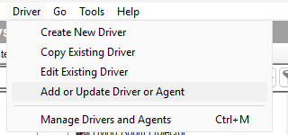

# Hue Bridge driver for Control4

[](https://github.com/corytron/c4-hue-driver/actions/workflows/ci.yml)
[](https://scorecard.dev/viewer/?uri=github.com/corytron/c4-hue-driver)
[](https://github.com/corytron/c4-hue-driver/releases/latest)
[](LICENSE)

An independent Control4 DriverWorks driver that works with Philips Hue bridges
over the bridge's local CLIP v2 API. Three `.c4z` drivers, **Hue Bridge**,
**Hue Light** and **Hue Scene**, turn the lights, rooms, zones and scenes of
one Hue bridge into ordinary Control4 lights that you switch, dim, colour and
program in Composer Pro like any other light.

A personal project for one Control4 home. It is not affiliated with, endorsed
by or supported by Snap One (Control4) or Signify (Philips Hue); see
[License, trademarks and provenance](#license-trademarks-and-provenance).

## What it does

- **Lights.** Each Hue light you import becomes a Control4 light (the
  `light_v2` proxy) with on/off, dimming, colour temperature and full colour
  where the bulb supports them. Capabilities come from what the light reports,
  so a white-only bulb shows no colour controls.
- **Two-way state.** The driver keeps the bridge's event stream
  (`/eventstream/clip/v2`) open, so changes made in the Hue app, by Hue
  switches and dimmers or by Hue automations show up in Control4 within a
  second or two and Control4 programming reacts to them. Changes arrive as
  events, not by polling: the driver reads the whole bridge when the stream
  connects, which it does again after ten quiet minutes and at least once an
  hour (**Stream Watchdog (s)**, **Stream Timeout (s)**), and when an action
  you click needs fresh data. No cloud account is involved and nothing
  leaves the house.
- **Rooms and zones as lights.** A Hue zone or room can be added as one Hue
  Light device whose tile, slider and colour controls move every lamp in it
  with a single request to the bridge.
- **Scenes as dimmers.** Any Hue scene, the time-of-day scenes (Golden hours,
  Natural light) included, can be a Hue Scene device: on plays the scene, off
  turns its room or zone off, and the slider brightens or dims the room or
  zone while keeping the scene's look. On a time-of-day scene, on starts the
  schedule.
- **Keypads.** Hue Light and Hue Scene devices offer Top, Bottom and Toggle
  Button Links: tap for on and off, hold for Hue's own smooth dimming, and the
  keypad LEDs follow the device, including changes made on the Hue side. The
  keypad settings are set in Composer as on any Control4 dimmer: the On
  preset and the click rates on a Hue Light, the hold rates and the LED
  colours on both. A Control4 switch can run as a decoupled two-button
  keypad for a Hue bulb.
- **Pairing from Composer.** Enter the bridge's address, press the link
  button, click Pair Bridge. The application key is stored encrypted on the
  controller and never shown. HTTPS only: the bridge's certificate is
  verified against Signify's root certificates, which ship with the driver,
  and at every start and after an address change the driver checks, before
  anything carries the key, that the bridge at the address is the paired one
  (by its bridge id) and that the controller really applies those roots (a
  TLS self-check).
- **Lifecycle handling.** Renames on either side, lights replaced or deleted in
  Hue, devices deleted in Composer, a bridge reset or replaced, a project
  restored from a backup: each is reported in a readable `Attention` line and
  resolved with a click (Adopt Hue Names, Re-link Device To Light, Forget
  Light, Link Devices, ...). The driver never creates, renames, moves or
  deletes a Control4 device on its own.
- **Readable Composer properties.** Status, Event Stream, Lights, Scenes, Zone
  Lights, Room Mappings and Last Action say in plain words what the driver is
  doing and what it did; long lists open as drop-downs, and a long Last Action
  continues on up to five more rows.
- **Polite to the bridge.** Commands are coalesced per light (a fast slider
  drag sends only the latest value) and paced at Hue's limits: about ten light
  commands a second, one grouped command a second.

## What you need

- A Control4 controller on **OS 3.3.0 or newer** (the `minimum_os_version` of
  the three drivers) and Composer Pro. Written and tested on **OS 3.4.2 with
  Composer Pro 3.4.2**; nothing OS-version-specific is used, but OS 4 has not
  been tried. Tested with a Hue Bridge Pro; the square version 2 bridge speaks
  the same CLIP v2 API and its certificate should chain to the same Signify
  roots, but it has not been tried.
- A **Philips Hue Bridge** (the square version 2 bridge, BSB002) or a **Hue
  Bridge Pro** (BSB003) on the same network as the controller, with a fixed
  IPv4 address (a DHCP reservation in your router). The driver finds the
  bridge by its address only. An address with a number below 8 in it
  (`10.0.2.143`, not `198.51.100.50`) gives the event stream a connection
  queue of its own; the manual's chapter 3 explains why.
- Not supported: the round first-generation bridge (BSB001), which has no CLIP v2
  API, and devices that are not Hue bridges; both are refused at pairing. The
  bridge's software must be 1948086000 or newer, or pairing is refused too
  (keep it updated in the Hue app; the driver shows it as Bridge Firmware).
- HTTPS from the controller to the bridge on port 443. No internet access and
  no Hue account are needed.

## What it is not

- No Hue motion sensors, buttons, dimmer switches or entertainment areas as
  Control4 devices (a Hue dimmer's effect on the lights still shows up).
- No Hue automations or MotionAware; what they do to the lights shows up.
- One bridge per project; a second Hue Bridge device is not supported.
- Hue's whole-home group ("all lights") is not offered as a light; zones and
  rooms are, one at a time.
- A personal project, offered as is. There is no support obligation, and
  your Control4 dealer may not support third-party drivers. Try it on a test
  system first and keep a Composer backup.

## Get it

### The release

Take the release marked **Latest** on the
[Releases page](https://github.com/corytron/c4-hue-driver/releases)
(<https://github.com/corytron/c4-hue-driver/releases/latest> always points at
it). Releases are numbered `X.Y` and tagged `vX.Y`; a major version carries a
codename from Star Wars: Andor, so 1.0 and every 1.x release is **"Cassian"**.
Every release is built and attached by the repository's Release workflow,
never by hand, and carries seven files:

- `hue_bridge.c4z`, `hue_light.c4z`, `hue_scene.c4z`: the three drivers.
  Download all three; they must come from the same release.
- `SHA256SUMS.txt`: the checksum of each package.
- `manifest.json`: what was built: `tag` and `version`, `build` (the **build
  number**, the integer the three drivers show as **Driver Version** in
  Composer once installed; Control4 needs an integer there, so the files
  carry the build number while the release is called 1.0), `commit`,
  `built_at`, `dev` (`false` in a release), and each package's `sha256` and
  size. The release notes name the build number too.
- `attestations.sigstore.json`: the Sigstore bundle of the build provenance
  the Release workflow signed for the packages (one attestation naming all
  three).
- `hue-drivers.intoto.jsonl`: the same provenance as in-toto JSON lines.

A later release of the same version moves the tag and replaces the attached
files with a newer build; Driver Version tells the builds apart. To check
what you downloaded:

```sh
sha256sum -c SHA256SUMS.txt                                          # the three packages
gh attestation verify hue_bridge.c4z --repo corytron/c4-hue-driver \
  --signer-workflow corytron/c4-hue-driver/.github/workflows/release.yml   # GitHub CLI 2.102.0 or newer; repeat per package
```

The second command confirms that the file was built and signed by this
repository's Release workflow, and fails otherwise. Add `--source-digest`
with the `commit` from `manifest.json` to confirm the commit as well, or
`--bundle attestations.sigstore.json` to check against the attached bundle
instead of the copy on GitHub. Older GitHub CLI versions match
`--signer-workflow` only as a prefix (advisory GHSA-wjmr-j3rp-mh2g).

### Build from source

`tools/build.sh` packages the three drivers with Snap One's public driver
packager, which you clone yourself (nothing of Snap One's is vendored here):

```sh
git clone https://github.com/snap-one/drivers-driverpackager ~/c4-tools/drivers-driverpackager
tools/build.sh          # -> build/hue_bridge.c4z, build/hue_light.c4z, build/hue_scene.c4z, build/manifest.json
tools/build.sh --dev    # development build: dev loop, Lua command window, the dev key; never install or share it as production
```

It needs bash, a full clone of this repository (the build number is the
commit count, so a shallow clone stamps the wrong one), Python 3 and `lxml`,
which the packager imports (`python3-lxml` on Debian and Ubuntu); set
`DP3=/path/to/dp3/driverpackager.py` if the packager lives elsewhere. CI and
the Release workflow fetch the packager at commit
`16eef8beb70303606f066524cda516b2aa7ce38d`. Each `.c4z` carries the `LICENSE`
and `NOTICE` files. A release build leaves out the development modules and
the `DEV-ONLY` parts of the bridge's `driver.xml`, and `tools/build.sh`
refuses to package one that still has them. Lint and tests run on Lua 5.1
with `luacheck`, `busted` and `dkjson` from luarocks (the versions CI pins are
in `.github/workflows/ci.yml`); the specs run the drivers against a fake
DriverWorks runtime (`tests/helpers/fake_c4.lua`) and invented Hue resources
(`tests/fixtures/hue_resources.lua`):

```sh
luacheck src tests tools
busted tests
```

`tools/check.sh` runs these two and every other check CI runs (shell, Python,
XML, PowerShell, workflows, secrets, the house's desired state), and
`tools/setup-checks.sh` installs the shell, Python, workflow and secrets
tools it needs (ruff, zizmor, shellcheck, actionlint, gitleaks) into
`~/.local/bin` without sudo; [CONTRIBUTING.md](CONTRIBUTING.md) lists the
checks.

## Install in Composer Pro

The **Documentation** tab of the **Hue Bridge** device holds the full owner's
manual (`src/hue_bridge/www/documentation.html`); a Hue Light or Hue Scene
device's Documentation tab is a one-page summary of that device. The manual's
chapters 3 to 7 and 9 are the long version of this list.

1. Copy the three `.c4z` files to the computer that runs Composer Pro.
2. **Driver > Add or Update Driver or Agent...**, select all three files at
   once (hold Ctrl) and open them. Composer answers *Update Succeeded*.
3. In System Design, select the room for the bridge, open the Items pane's
   **Search** tab and type `Hue Bridge`. Pick the **Hue Bridge** by
   manufacturer *Philips Hue* with the model text *Hue Bridge (CLIP v2)* (the
   search also finds Control4's own Hue drivers) and double-click it. Do not
   add a Hue Light or Hue Scene from the Items pane: the bridge creates them.
4. On the bridge's **Properties** tab, type the bridge's address into **Bridge
   IP Address** (the Hue app shows it under Settings > My Hue system) and
   click the row's **Set** button. Status reads *Not paired: press the link
   button, then run Pair Bridge*.
5. Press the round **link button** on the bridge, then within 30 seconds click
   **Pair Bridge** on the **Actions** tab. Status goes *Pairing: contacting
   bridge*, *Pairing: found Hue Bridge Pro (BSB003) ..., requesting key*,
   **Paired**; Bridge ID, Bridge Model, Bridge Name and Bridge Firmware fill
   in, Event Stream reads *Connected since ...*, Lights reads for example *47
   on bridge, 0 imported, 47 new, ...*, Attention lists the new lights, and
   Room Mappings is filled by a one-time automatic **Map Rooms By Name**.
6. **Rooms.** Open the Room Mappings drop-down; map what is still
   *(unmapped)* with **Set Room Mapping** (zones too), or click **Map Rooms By
   Name** again after creating rooms. A mapping decides only where new devices
   land; it never moves anything.
7. **Lights.** **Add Light** creates one Hue Light in a room you pick;
   **Import All New Lights** creates every new light whose Hue room is mapped;
   **Add Zone Light** makes a Hue zone or room into one light.
8. **Scenes.** **Add Scene** creates one Hue Scene (time-of-day scenes are
   listed as *(time-based)*); **Add All Scenes Of Room** creates every scene of
   one Hue room or zone.
9. **File > Refresh Navigators**, so the touch screens and the app show the
   new tiles.

<!-- Screenshots. Only add-driver-menu.png is used here: the licensing research
     (docs/licensing-research.md, section 4 and section 6 step 4) rates it
     clean. room-mappings.png is flagged P5 (the house's room and zone names,
     low-medium) and also shows a development build (Dev Server rows); it
     goes back in here once retaken on a release build without the house's
     texts (#61, docs/screenshots-plan.md). Never reference
     bridge-properties.png here (the house bridge's id, P3; the device
     inventory picture of P4 has left the repository);
     light-properties.png and scene-properties.png carry the owner's light and
     scene identifiers (P6); bridge-actions.png is clean but predates Add Zone
     Light and Re-link Zone Light and shows three development-only actions. -->



### Updating

Updates go through the same **Add or Update Driver or Agent...** menu with the
three new files: Composer pushes the new version to every existing device, and
the pairing, the lights and the scenes are untouched. **Always update in
place; never delete and re-add the Hue Bridge device.** The pairing and the
list of which device is which light live on it; a re-added bridge starts
empty.

If Composer asks **Restart Director?**, the new build changes a driver's
capabilities. Answer Yes, then **reboot the controller from System Manager**
(Tools > System Manager): the new code loads only with the reboot, and until
then the affected devices keep the old Driver Version. Builds that change only
Lua or connections take effect at once.

## Use it

- **On Navigators** each Hue Light and Hue Scene is a tile with a slider on
  its room's Lighting page, with colour controls where the light has them.
  Changes from the Hue side reach the tile within a second or two.
- **In programming** a Hue Light has the standard actions and events of a
  Control4 dimmer, and its events fire for changes made on the Hue side too. A
  Hue Scene is a dimmer whose level is its room or zone's brightness; its on
  event fires when the scene is played, from anywhere.
- **Advanced Lighting Scenes** can hold Hue Lights (level, colour) and Hue
  Scenes (a level plays or dims the scene) as members.
- **Keypads.** A Hue bulb has to stay powered, so run the wall switch as a
  two-button keypad (*Use as 2 Button Keypad* on, *Buttons Control Load* off,
  its own load set to 100 % by programming) and in Connections bind its
  buttons to the Hue Light's or Hue Scene's **Top**, **Bottom** or **Toggle
  Button Link**. Tap top = on (a light to its On preset, 100 % unless changed;
  a scene played), tap bottom = off, hold = Hue dims up or down until
  released; the LEDs follow the device. The keypad settings are the device's
  own rows in Composer: the On preset (100 %) and the click rates (250 ms) on
  a Hue Light, the hold rates (5 s for the full range) and the LED colours
  (blue) on both. After an update from a build that hid them, they appear
  once the controller has been rebooted from System Manager.
- **Device properties** are written by the bridge: a Hue Light shows Status,
  Hue Light ID, Hue Name, Model, Online, Hue Room and Last Action; a Hue Scene
  shows Status, Hue Scene, Hue Room, Hue Scene ID, Online and Last Action;
  both show Driver Version. Yours to set: **Recall As** on a scene (how ON
  plays the scene), the keypad settings, and **Debug Mode** (diagnostics
  only); click the row's Set button after changing one. Each device has two
  actions, **Adopt Hue Name** and **Forget This Light** / **Forget This
  Scene**.

## Troubleshooting

Click **Test Connection** on the bridge first: *Test OK* means the controller
reaches the bridge, the bridge is the paired one and it accepts the key. Then
the manual:

- chapter 4: pairing failures, the bridge offline, the bridge's address
  changed;
- chapter 8: a light renamed, replaced or deleted, a device deleted in
  Composer, the bridge reset or replaced, a project restored from a backup;
- chapter 9: scenes deleted, renamed or edited in Hue, time-of-day scenes;
- chapter 12: every text the properties can show and what to do about it, and
  "things that look wrong but are not";
- chapter 13: limits and a quick reference of all actions.

The design notes behind the driver are in [`docs/`](docs/README.md): the
architecture (`docs/design.md`), the feature contracts, and the edge-case
research that decided what is automatic, what is only offered and what is
never done without a click.

### Reporting a problem

Open a GitHub issue with the **Driver Version**, the Control4 OS version, the
bridge model, the texts of **Status**, **Event Stream**, **Attention** and
**Last Action** (with **Last Action (2)** to **(6)** when shown), and the
relevant lines of the Lua output (the device's Lua tab in Composer; **Debug
Mode** On if asked, and Off again afterwards). Replace your LAN addresses and
the bridge id with placeholders. The driver never shows the application key;
never paste one. Pull requests are welcome; see
[CONTRIBUTING.md](CONTRIBUTING.md).

## Repository layout

```
src/common/        shared modules: dispatch and log (all three drivers), device (what the
                   light and scene drivers share: proxy, keypad machine and settings, LEDs,
                   binding re-check), devloop (development builds only); build.sh adds
                   build_version.lua, and the dev key to a development build
src/hue_bridge/    the bridge driver: driver.lua, driver.xml, bridge/ (HTTP, TLS self-check,
                   event stream, SSE parsing, pairing, credentials, command queue, lights,
                   scenes, zone lights and the lifecycle base they share, registry; devtools,
                   conntest and pinning for development builds only), certs/ (Signify's two
                   root certificates, their bundle and the TLS self-check's decoy CA), www/
                   (the manual, its screenshots, the icons)
src/hue_light/     the light driver (light_v2 proxy; also zone and room lights): light/
                   (capabilities, state), www/ (its Documentation page, the icons)
src/hue_scene/     the scene driver (light_v2 proxy, a dimmer), www/ as for the light
tests/             busted specs (spec/), the fake DriverWorks runtime (helpers/), invented
                   Hue resources (fixtures/)
tools/             build.sh; check.sh (every check, as CI runs it) and setup-checks.sh (its
                   tools, the Python ones hash-pinned in requirements-checks.txt); deploy.py
                   (the house: release download and verification, the deployment record, the
                   brief); labels_sync.py; code_scanning_issue.py (the one issue listing the
                   open code scanning alerts); gh-discussion.py (reports to Discussions); the
                   unit tests of the Python tools in tests/; the dev loop (devserver.py,
                   devctl.py, regress.sh, smart_scene_probe.py); the Windows session's
                   Composer automation (composer/Composer.psm1, composer/Shots.ps1, and
                   collect.py, which receives its screenshots); the icon and CA-bundle
                   generators (make_icons.py, gen_ca_bundle.sh)
deploy/            house.yaml: the desired state of the author's house (release, build, stream
                   settings); the observed state is a GitHub Deployment, see below
docs/              design notes, feature contracts, research, reviews, checklists (see
                   docs/README.md)
.github/           the workflows (CI, Release, drift, labels, Scorecard, code scanning
                   triage, Dependabot auto-merge), the labels, Dependabot's settings, the
                   release-note categories, the issue and pull request templates, CODEOWNERS
```

At the top level: `LICENSE` and `NOTICE`, `CONTRIBUTING.md`, `SECURITY.md`,
`CODE_OF_CONDUCT.md`, `CLAUDE.md` (the working rules of the AI sessions that
build and test the drivers) and the settings of luacheck (`.luacheckrc`),
busted (`.busted`), ruff (`ruff.toml`) and gitleaks (`.gitleaks.toml`).

## How a change reaches the house

The author's house is the one installation, and it is run from the repository
([`docs/cicd-gitops-design.md`](docs/cicd-gitops-design.md)):

1. A change is a pull request. Four checks must pass before it can merge:
   *Lint and test (Lua 5.1)*, *Build the three .c4z packages*, *Tooling
   checks (shell, Python, XML, workflows)* and *Secrets and private data*;
   the branch must be up to date with `main` and every review conversation
   resolved. `main` takes nothing else, and the rule binds the maintainer
   too.
2. A release is cut from `main` by the Release workflow (Actions ▸ Release ▸
   Run workflow ▸ version, or a pushed `vX.Y` tag on a commit of `main`): it
   lints, tests, builds, and attaches the packages, the checksums, the
   manifest and the attestations described above.
3. [`deploy/house.yaml`](deploy/house.yaml) says which release and build the
   house should run. Changing it is a pull request of its own.
4. The `house` environment on the repository's
   [Environments page](https://github.com/corytron/c4-hue-driver/deployments/house)
   records what was actually installed. A workflow compares the two and keeps
   one issue labelled `deploy` open while they differ.
5. `python3 tools/deploy.py start` downloads the release, verifies the
   checksums, the manifest and the attestations, records the deployment and
   writes a brief; the author's Windows Composer session installs the three
   files from the GitHub release URLs through *Add or Update Driver or
   Agent...* (the controller has no install API, so this click is never
   automatic); `python3 tools/deploy.py done` records the result, which
   closes the issue.

What the house runs is therefore read off the Environments page, not off
this file.

## Status

[`docs/status.md`](docs/status.md) is the one-page current state: what the
three drivers do today, what was verified on hardware (pairing, the event
stream and resync, import and the whole light lifecycle, scenes, keypad taps
and holds with LEDs, the keypad settings, time-of-day scenes, zone lights
from the phone and the keypad, a light staying bound through a controller
reboot, the TLS self-check) and what is open. What the author's house runs, a
controller on OS 3.4.2 with a Hue Bridge Pro, two Hue Scene devices, two zone
lights and a two-button keypad bound to a scene, is the newest successful
deployment on the
[Environments page](https://github.com/corytron/c4-hue-driver/deployments/house);
the newest release is on the
[Releases page](https://github.com/corytron/c4-hue-driver/releases/latest).

Every open item is an [issue](https://github.com/corytron/c4-hue-driver/issues).
On 2026-10-25 they are: installing the current release on the house (#228),
the remaining hardware checks of the time-of-day scenes (#40) and the
owner's pass on the phone and keypads (#38), measuring how often the stream
resyncs on the house (#65), retaking the manual's screenshots (#61), cleaning
up old pull-request revisions (#62), and the decision on the OpenSSF Best
Practices badge (#224). A known limit rather than an open item: in a room's
List View, Hue Lights and Hue Scenes show Control4's standard light picture,
and the drivers' icons appear in the project tree only (verified 2026-10-25,
#60).

## License, trademarks and provenance

Licensed under the **Apache License, Version 2.0**; see [`LICENSE`](LICENSE)
and [`NOTICE`](NOTICE). The software is provided "AS IS", without warranties
or conditions of any kind. It drives lighting in a home through a Control4
controller and a Hue bridge; try it on a test system first, keep a Composer
backup, and understand that your dealer may not support third-party drivers.

Philips Hue and Hue are trademarks of Signify Holding B.V. Philips is a
registered trademark of Koninklijke Philips N.V. Control4, Composer and
DriverWorks are trademarks of Snap One, LLC. This project is not affiliated
with, endorsed by or supported by Signify or Snap One; "works with Philips
Hue" and "for Philips Hue" describe compatibility and nothing more, and no
logo or badge of either company is used.

Use of the Hue bridge API is subject to Signify's
[Hue Developer Program Terms](https://developers.meethue.com/terms-of-use-and-conditions/);
you pair the driver with your own bridge and your own key. Composer Pro and
DriverWorks are licensed by Snap One to Control4 dealers; the driver was
written against Snap One's DriverWorks documentation as published on GitHub,
and nothing from Snap One's SDK repositories (code, libraries or
documentation text) is included here. The two root CA certificates in
`src/hue_bridge/certs/` (`hue_root_bridge.pem` and `hue_root_ca_01.pem`, and
`hue_ca_bundle.pem`, which joins them) are public key material published by
Signify for verifying Hue bridges, included unmodified and not covered by
this project's license (see `NOTICE`). The third certificate there,
`decoy_ca.pem`, is this project's own: a self-signed CA whose private key was
destroyed when it was made, used only by the TLS self-check.

Written by Cory Fair with AI pair-programming (Anthropic's Claude, through
Claude Code; see the `Co-Authored-By` trailers in the history). The copyright
is Cory Fair's.
